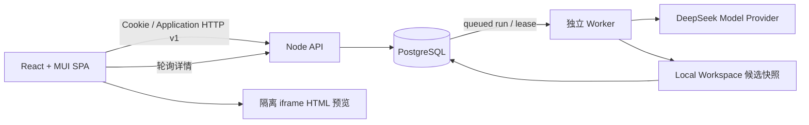

# 当前架构与维护约束

最近更新：TASK-042。能力与验收范围见 [STATUS](STATUS.md)、[INTEGRATION-STATUS](INTEGRATION-STATUS.md)，源文件导航见 [CODEBASE-MAP](CODEBASE-MAP.md)。

## 当前实际调用链

- Web 使用 React、TypeScript、MUI、React Router 和 TanStack Query。`app` 装配主题/会话/路由，`pages` 展示账号/首页/历史/详情，`api` 校验公共 Application v1 响应，`features/auth` 与 `features/tasks` 管理服务器状态。浏览器缓存不承担持久化。共享 `RequestComposer` 处理需求输入与键盘；详情工作台通过 `ConversationPanel` 将持久化 Run 按时间投影为用户需求和真实状态回复，底部固定需求输入；预览/代码及移动页签均通过可见性切换保留同一个 iframe。进展仍由详情轮询驱动，仅反映 queued/running 等实际状态，不推断 Agent 内部阶段。
- API 通过数据库会话识别用户，做输入校验/同源校验/权限判断，并事务排队；不在 HTTP 生命周期调用模型或执行生成代码。API 和独立 Worker 都由同一 bootstrap 装配唯一 Postgres ApplicationRepository，DATABASE_URL 缺失或数据库不可达就明确失败，没有本地内存业务回退。
- 注册事务创建用户、个人 Organization/Membership 和登录 Session。密码用带随机盐的 scrypt；Cookie 为 HttpOnly/SameSite，数据库只保存随机 session token 的摘要；服务器 HTTPS 使用 COOKIE_SECURE。
- 产品“历史任务”对应 Project，多次提交对应不同 Run。用户隔离在数据库查询条件中强制执行，跨用户读取/修改统一 404；列表只读 summary，不加载所有源码或运行结果。
- 初次 Run 已绑定持久化模板版本，修改从上次成功完整源码快照开始。项目最多一个 queued/running；幂等键、事务锁和唯一索引共同控制并发。Worker 使用 SKIP LOCKED claim、可续约 lease；过期 running 明确失败，不自动重复潜在付费调用。
- Worker 只把源码作为数据交给 LocalWorkspace 和 Agent。真实 Builder/Reviewer 使用多轮 action→Workspace observation→action loop；每次终结在事务中写入持久化唯一版本、完整 source_files、manifest、HTML、review 与 Run result。失败不覆盖成功作品，失败候选版本/错误仍有独立记录。重启后读取数据库快照，不能静默改成空模板或仅携带 HTML。
- DeepSeek 由 Worker 环境 DSKEY 装配；产品没有替代模型路径，缺少密钥在 Worker 中明确失败。Reviewer 只读，构建/浏览器检查目前仍是确定性 Workspace seam。需要真实模型的测试必须显式提供 DSKEY。
- 生产 API 托管 Vite 产物及客户端路由；缺失 assets/API 不返回 HTML。开发 API/Vite/HMR 共用 8787，另起同一 Worker。Compose 则使用同一镜像分别启动 API/Worker，并部署同一 PostgreSQL；没有另一个本地数据库实现。
- 预览交付与源码审查分开：Workflow先做不执行脚本的HTML静态检查，缺失/空挂载、外部资源或不支持脚本进入有界修复；保存成功版本还必须保证预览非空且与source_files一致。源码Reviewer pass不能跳过该门禁；静态门禁也不冒充真实浏览器验证。模型格式纠错由应用显式启用，网关默认关闭以保留其他调用方行为；纠错以独立对话轮次带回原错误答案与字段反馈，仍受原重试次数限制。原答案只在内存中用于纠错，后台仅记录失败阶段、截断/JSON/Schema分类、字段路径和调用用量，不记录源码或Provider原文。
- 隔离预览使用唯一 iframe + sandbox/CSP；React 稳定 portal 在连接宿主后创建 iframe，原生 dialog 负责全窗口、焦点与 Esc。生成 HTML 不注入平台 DOM，不在宿主/API/Worker 执行。`SourceEditor` 使用本地打包的 CodeMirror 6，仅编辑实际交付的独立 HTML 产物；首次代码页签加载独立 chunk，后续切换保留实例/选区/历史，外部恢复或载入新版本重置撤销历史，本页 React 草稿在 250ms 防抖后进入同一隔离预览；不更新 Query 缓存、数据库、历史版本或后续模型上下文。草稿保留基准版本，新服务端版本到达需显式替换已有编辑；审查仍绑定保存版本，不代表草稿通过审核。

## 保持的约束

1. 密钥只在后端环境，不写入源码、模型输入、页面、日志或版本；真实 Provider 错误必须明确失败。
2. 生成项目 install/build/test 必须使用隔离执行 Adapter；不向生成项目或公网接口暴露 Docker socket、数据库或其他基础服务。
3. Project Version 不可覆盖。审核与预览绑定持久化版本 ID；旧版审核不能冒充本轮审核通过。
4. 认证和任务读写必须走数据库用户条件，客户端提交 userId/previousHtml 不能作为授权或修改上下文。
5. 数据迁移只追加，不改已应用 checksum。原0001保留，0002扩展真实应用；本地和服务器使用同一执行器与迁移。
6. 部署/发布等外部副作用仍需授权、幂等与审计；当前真实应用部署不代表已实现“发布生成项目”能力。
7. 正式执行/领域 v0 Contracts 保持兼容；Application HTTP v1 作为新增版本独立定义，修改调用双方和测试，不在页面偷偷兼容不同响应。

## 架构取舍与未接入模块

[Postgres/账号/队列 ADR](adr/0006-postgres-accounts-and-task-history.md) 记录当前持久化取舍。未装配的发布、事件投影和真实沙箱接口只保留 Contracts，不属于当前网站调用链。Redis/Temporal、生产沙箱 executor、产品 Reviewer 浏览器和真实生成项目发布尚未接入，原 ADR 的 accepted 不能当作实现证据。
