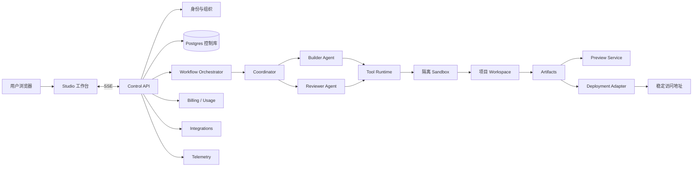

# Atoms Builder V1 完整设计文档（历史建设方案）

> 2026-11-11 归档（TASK-019）。本文记录零到一目标与设计，包含未实现能力，不是维护任务清单，也不是现状说明。有效约束已提炼到 [当前架构](../../ARCHITECTURE.md) 和 [ADR](../../adr/)；当前缺口见 [STATUS](../../STATUS.md)。后续不在本文追加功能设计。


状态：Draft for implementation

目标：构建一个面向非专业开发者的 AI 产品构建平台。用户用自然语言描述一个 Web 项目，平台让 Builder Agent 在隔离工作区中生成和修改项目，再由 Reviewer Agent 自动验证，用户可以预览、审批和发布结果。

本版本只承诺一条可靠闭环：**一个 Coordinator 管理一个 Builder Agent 和一个 Reviewer Agent**。不做多 Builder 并行、不做 Race Mode、不做 SEO/Ads Agent、不做移动端和视频输出。

## 1. 产品结果和验收标准

### 1.1 用户可以完成的事情

用户必须能够：

1. 注册并创建组织。
2. 创建一个 Web 项目。
3. 用自然语言描述页面、用户、功能和视觉要求。
4. 看到 Builder Agent 的实时进度。
5. 获得一个可以打开的预览地址。
6. 继续用自然语言修改同一个项目。
7. 看到 Reviewer Agent 的测试报告和证据。
8. 在审核通过后发布一个稳定地址。
9. 查看项目版本并恢复到之前的版本。
10. 导出项目文件。

### 1.2 一期明确支持

- Web 项目：营销页、作品集、仪表盘、内部工具和简单 SaaS 页面。
- Next.js + TypeScript 项目模板。
- React 页面、表单、客户端交互和服务端 API Route。
- 预览、构建、Lint、TypeScript 检查和浏览器测试。
- 项目文件编辑和 ZIP 导出。
- GitHub 导出作为实验性集成。
- 基础账号、组织、项目权限和用量额度。
- 静态或服务端 Web 部署。

### 1.3 一期暂不支持

- 任意语言和任意框架。
- 自动创建复杂云基础设施。
- 多个 Builder Agent 同时改同一个工作区。
- 自动投放广告、自动付款、自动发送邮件。
- 生产数据库的任意 SQL 权限。
- 让生成代码直接访问控制平面数据库。
- 手机 App、视频、幻灯片、研究报告输出。
- 企业 SSO、私有部署和跨组织协作。

### 1.4 完成定义

一次构建只有同时满足以下条件才算成功：

- 目标项目文件已写入项目版本。
- `install`、`lint`、`typecheck` 和 `build` 成功。
- 预览服务可以启动并返回健康状态。
- Reviewer Agent 的关键浏览器流程通过。
- 页面没有高危 Secret、未授权外链或明显运行时错误。
- 用户可以查看版本、预览、继续修改或发布。

## 2. 设计原则

1. **先闭环，再扩展 Agent 数量。** Builder 和 Reviewer 的可靠性比 Agent 数量重要。
2. **Agent 只通过工具改变世界。** Agent 不直接访问宿主机、数据库或部署凭证。
3. **每个副作用都可追踪。** 文件修改、命令、部署、扣费和外部集成都必须有事件记录。
4. **版本不可变。** 修改产生新版本，不能在后台悄悄覆盖用户正在看的版本。
5. **每个动作可恢复。** 长任务可以重试、暂停、取消和从最后一个安全点继续。
6. **验证必须使用证据。** Reviewer 必须返回命令输出、截图、访问路径和失败原因。
7. **默认最小权限。** Agent 没有工具就没有能力；没有审批就不能产生外部副作用。
8. **实现 Agent 优先使用深模块。** 复杂执行细节隐藏在少量接口之后，便于替换 Adapter 和测试。

## 3. 系统边界

当前部署目标是单台腾讯云 CVM + Docker Compose。模块接口必须保持和部署环境无关，单 CVM 只是 Deployment Profile；后续可以把 Sandbox、Database、Artifact Store 和 Deployment 替换成独立云服务。



系统分成三个平面：

### 3.1 Control Plane

负责用户、组织、项目、版本、运行、审批、额度、集成和部署记录。它不执行生成代码。

### 3.2 Execution Plane

负责 Agent、模型调用、工具执行、沙箱、测试、截图和构建。它只能通过受控接口访问 Control Plane。

### 3.3 Product Runtime Plane

负责预览和已发布项目的运行。它和 Control Plane 隔离，生成项目不能读取平台的管理数据库或密钥。

## 4. 推荐代码仓库结构

使用 pnpm + Turborepo 的 TypeScript monorepo：

```text
atoms-builder-v1/
├── apps/
│   ├── studio/                 # Next.js 用户工作台
│   ├── control-api/            # HTTP API、SSE、鉴权后的命令入口
│   ├── workflow-worker/        # Temporal Worker
│   └── sandbox-runner/         # 沙箱内启动脚本和健康检查
├── packages/
│   ├── domain/                 # 领域类型、状态机、规则
│   ├── contracts/              # API、事件、Agent 输出的 Zod Schema
│   ├── agent-runtime/          # Agent 循环、上下文和工具权限
│   ├── tool-runtime/           # 工具注册、审计、超时、配额
│   ├── workspace/              # Workspace 接口和 Adapter
│   ├── model-gateway/          # 模型路由、成本和重试
│   ├── persistence/            # Drizzle、Repositories、迁移
│   ├── deployment/             # 部署接口和 Provider Adapter
│   ├── integrations/           # GitHub、Supabase 等集成
│   ├── ui/                     # 共享 UI
│   └── observability/          # 日志、指标、Trace
├── templates/
│   └── next-web/               # 受支持的项目骨架
├── migrations/
├── docs/
│   ├── DESIGN.md
│   └── adr/
└── CONTEXT.md
```

第一阶段不拆成多个独立微服务。`control-api`、`workflow-worker` 和 `sandbox-runner` 是运行角色，不等于必须拥有独立服务边界。只有出现独立扩缩容、权限或故障域时才拆分。

## 5. 领域模型

### 5.1 Organization 和 Membership

```ts
type Organization = {
  id: string
  name: string
  plan: "free" | "pro"
  createdAt: Date
}

type Membership = {
  organizationId: string
  userId: string
  role: "owner" | "editor" | "viewer" | "billing"
}
```

权限规则：

- owner：所有操作，包括成员、账单、集成和删除组织。
- editor：创建和修改项目，不能管理账单和组织成员。
- viewer：查看、预览和下载有权限的版本。
- billing：查看和管理账单、额度，不能修改项目。

### 5.2 Project 和 Project Version

```ts
type Project = {
  id: string
  organizationId: string
  name: string
  kind: "web"
  currentVersionId: string | null
  visibility: "private" | "public"
  status: "active" | "archived" | "deleted"
}

type ProjectVersion = {
  id: string
  projectId: string
  parentVersionId: string | null
  source: "builder" | "manual_edit" | "restore" | "import"
  manifest: FileManifest
  status: "candidate" | "current" | "superseded" | "failed"
  createdByRunId: string | null
}
```

项目版本的文件内容存储在对象存储或沙箱快照中，数据库只保存 manifest、hash、大小和对象引用。版本一旦进入 `current` 或 `superseded`，文件内容不可变。

### 5.3 Run、Step、Event

```ts
type Run = {
  id: string
  projectId: string
  inputVersionId: string
  requestedByUserId: string
  kind: "build" | "modify" | "review" | "publish" | "restore"
  status: RunStatus
  cancelRequestedAt: Date | null
  budget: UsageBudget
}

type RunStep = {
  id: string
  runId: string
  kind: "intake" | "build" | "review" | "repair" | "publish"
  status: StepStatus
  attempt: number
  startedAt: Date | null
  finishedAt: Date | null
}

type RunEvent = {
  id: string
  runId: string
  stepId: string | null
  sequence: number
  type: EventType
  payload: unknown
  createdAt: Date
}
```

`RunEvent` 是追加式日志。任何面向用户的聊天、进度和审计视图都从事件投影得出，不直接依赖 Worker 的内存。

## 6. Run 状态机

```text
queued
  → planning
  → awaiting_approval
  → building
  → reviewing
  → awaiting_fix_decision
  → publishing
  → completed

任何非终态 → cancelling → cancelled
任何可恢复步骤 → retrying → 原状态
任何状态 → failed
```

规则：

- 计划阶段只有在请求涉及外部集成、生产部署、付费操作或高风险命令时才强制审批。
- Builder 完成后必须自动触发 Reviewer。
- Reviewer `pass` 才能进入发布阶段。
- Reviewer `fail` 时最多自动修复 3 次；第 3 次仍失败则进入 `awaiting_fix_decision`。
- 发布只能针对明确的 `ProjectVersion`，不能针对沙箱当前目录。
- 用户取消只阻止后续步骤，并尝试停止当前沙箱；不能假设已经撤销外部副作用。

## 7. 各模块设计

### 7.1 Studio 工作台

职责：展示项目、聊天、实时进度、文件树、预览、审核报告、版本和发布。

页面：

```text
/                         # 项目列表
/projects/new             # 新建项目
/projects/:id             # 项目工作区
/projects/:id/chat        # Chat + 事件流
/projects/:id/files       # 文件树和只读编辑器
/projects/:id/preview     # App Viewer
/projects/:id/versions    # 版本
/projects/:id/deployments # 发布记录
/settings/billing         # 额度和账单
```

Studio 不直接调用模型或沙箱。所有动作都调用 Control API，并通过 SSE 接收 `RunEvent`。

主要组件：

- `ProjectComposer`：提交初始需求和后续修改。
- `RunTimeline`：按步骤展示 Agent 和工具事件。
- `VersionViewer`：预览、比较和恢复版本。
- `AppViewer`：加载预览地址，并显示浏览器测试结果。
- `ReviewPanel`：展示通过项、失败项、证据和建议。
- `ApprovalCard`：展示风险、影响范围和用户审批按钮。

### 7.2 Control API

职责：鉴权、参数验证、权限检查、创建 Run、查询项目状态、发布命令和 SSE。

推荐 HTTP 接口：

```text
POST   /v1/projects
GET    /v1/projects/:projectId
POST   /v1/projects/:projectId/runs
GET    /v1/runs/:runId
POST   /v1/runs/:runId/cancel
POST   /v1/runs/:runId/approve
POST   /v1/runs/:runId/reject
GET    /v1/runs/:runId/events
GET    /v1/projects/:projectId/versions
POST   /v1/projects/:projectId/versions/:versionId/restore
POST   /v1/projects/:projectId/deployments
GET    /v1/projects/:projectId/deployments
GET    /v1/usage
```

接口规则：

- 所有写接口必须带 `Idempotency-Key`。
- 任何项目资源查询都必须检查组织成员关系。
- API 不接收任意 shell 命令。
- API 不接受模型生成的 SQL 直接执行。
- Run 创建成功后立即返回 `runId`，执行结果通过 SSE 查询。

### 7.3 Persistence 模块

职责：保存控制平面状态、事件、版本引用、额度和集成授权引用。

数据库表：

```text
users
organizations
memberships
projects
project_versions
project_files
runs
run_steps
run_events
artifacts
approvals
previews
deployments
integrations
secrets_refs
usage_ledger
idempotency_keys
```

关键约束：

- 每张租户表必须有 `organization_id` 或能通过项目追溯到组织。
- `project_versions(project_id, hash)` 唯一。
- `run_events(run_id, sequence)` 唯一。
- `usage_ledger` 只能追加，冲正通过负记录完成。
- 删除项目先软删除；物理删除由异步清理工作流执行。

Repository 接口示例：

```ts
interface ProjectRepository {
  getForMember(projectId: string, member: Membership): Promise<Project>
  create(input: CreateProject): Promise<Project>
  setCurrentVersion(projectId: string, versionId: string): Promise<void>
  listVersions(projectId: string): Promise<ProjectVersion[]>
}
```

### 7.4 Workflow Orchestrator

职责：持久化运行状态、编排步骤、重试、取消、等待审批和恢复。

实现：Temporal Workflow；模型调用、沙箱命令、构建、浏览器测试和部署均作为 Activity。Temporal 的 TypeScript SDK提供 Workflow、Activity、Worker、取消、超时和消息传递等原语。[官方文档](https://docs.temporal.io/develop/typescript)

工作流伪代码：

```ts
async function projectRunWorkflow(input: RunInput) {
  await recordStep("intake")
  const spec = await intakeActivity(input.prompt)

  await recordStep("build")
  const build = await builderActivity({
    projectId: input.projectId,
    versionId: input.inputVersionId,
    spec,
  })

  await recordStep("review")
  let review = await reviewerActivity(build.versionId)

  for (let attempt = 1; attempt <= 3 && review.status === "fail"; attempt++) {
    await recordStep("repair", attempt)
    await builderRepairActivity(build.versionId, review)
    review = await reviewerActivity(build.versionId)
  }

  if (review.status !== "pass") {
    return await waitForUserDecision("fix_or_publish_blocked")
  }

  if (input.publish) {
    await waitForApprovalIfRequired(input)
    await publishActivity(build.versionId)
  }

  return { status: "completed", versionId: build.versionId }
}
```

所有 Activity 必须：

- 有明确超时。
- 有重试策略。
- 有幂等键。
- 把外部副作用的结果写入数据库或事件。
- 不把完整源码放进 Temporal history，使用对象存储引用。

### 7.5 Coordinator

Coordinator 是运行级 Agent Manager，不直接修改代码。它负责：

- 读取当前项目状态和用户需求。
- 决定是否需要 Builder、Reviewer 或审批。
- 维护当前任务和预算。
- 根据 Reviewer 报告安排修复。
- 将每个阶段转换成结构化 `StepPlan`。

```ts
interface Coordinator {
  startBuild(input: BuildRequest): Promise<StepPlan>
  continueAfterReview(input: ReviewReport): Promise<NextAction>
  decideOnFailure(input: FailureContext): Promise<FailureAction>
}
```

Coordinator 不应获得文件写入工具。写入权限只授予 Builder。

### 7.6 Builder Agent

Builder 的职责是把明确的 `ProjectSpec` 变成一个可运行的项目版本，并根据 Reviewer 报告修复问题。

Builder 输入：

```ts
type BuilderInput = {
  projectId: string
  inputVersionId: string
  userRequest: string
  projectSpec: ProjectSpec
  reviewReport?: ReviewReport
  budget: UsageBudget
}
```

Builder 工具：

```text
workspace.read_manifest
workspace.read_file
workspace.search_files
workspace.apply_patch
workspace.create_file
workspace.delete_file       # 需要理由，且禁止删除受保护文件
workspace.run_check         # lint / typecheck / test / build
workspace.start_preview
workspace.inspect_preview
workspace.capture_screenshot
```

Builder 禁止：

- 直接执行任意 shell。
- 访问 Control Plane 数据库。
- 读取其他项目文件。
- 读取未授权 Secret。
- 直接发布生产部署。
- 修改测试报告或审核状态。

Builder 每轮输出：

```ts
type BuilderResult = {
  status: "completed" | "blocked" | "failed"
  versionId: string
  changedFiles: string[]
  checksRequested: CheckSpec[]
  assumptions: string[]
  remainingRisks: string[]
}
```

Prompt 结构固定为：

```text
身份：你是项目 Builder，只能通过提供的 Workspace 工具改动项目。
目标：实现 ProjectSpec 和当前用户请求。
约束：遵守受支持模板、工具权限、预算和受保护文件规则。
流程：理解 → 检查现状 → 计划 → 小批量修改 → 检查 → 修复 → 汇报。
完成条件：所有关键检查通过，预览可以启动，不能留下未说明的错误。
```

Builder 不需要知道整个聊天历史，只需要看到：当前需求、项目摘要、相关文件、最近版本、Reviewer 报告和未解决风险。

### 7.7 Reviewer Agent

Reviewer 默认只读。它的目标不是重新实现功能，而是验证 Builder 的结果。

Reviewer 检查顺序：

1. 文件结构和受支持模板。
2. 依赖安装。
3. Lint。
4. TypeScript。
5. 单元测试。
6. Build。
7. 预览服务健康状态。
8. 核心浏览器流程。
9. 响应式和明显视觉错误。
10. Secret、危险外链和权限问题。

Reviewer 工具：

```text
workspace.read_manifest
workspace.read_file
workspace.run_check
workspace.start_preview
browser.open
browser.click
browser.fill
browser.assert
browser.screenshot
security.scan
```

Reviewer 禁止：

- 修改文件。
- 安装依赖。
- 发布项目。
- 修改审核结果。
- 直接调用外部付费 API。

Reviewer 输出：

```ts
type ReviewReport = {
  status: "pass" | "fail" | "blocked"
  score: number
  checks: ReviewCheck[]
  failures: ReviewFailure[]
  evidence: EvidenceRef[]
  mustFix: string[]
  shouldFix: string[]
  risks: string[]
}
```

每个失败必须包含：命令或 URL、预期、实际结果、证据引用、建议修复位置。

### 7.8 Agent Runtime

负责通用 Agent 循环，不包含具体业务角色。

```ts
interface AgentRuntime {
  run<TInput, TResult>(definition: AgentDefinition<TInput, TResult>, input: TInput): Promise<TResult>
}

type AgentDefinition<I, O> = {
  name: string
  systemPrompt: string
  inputSchema: ZodSchema<I>
  outputSchema: ZodSchema<O>
  tools: ToolGrant[]
  maxSteps: number
  maxCost: number
}
```

Runtime 必须实现：

- 结构化输出校验。
- Tool Call 审计。
- 最大步骤数。
- token 和费用上限。
- 单工具超时。
- 模型重试。
- 上下文压缩。
- 中断和恢复。
- Prompt 和模型版本记录。

### 7.9 Model Gateway

模型访问统一经由 Adapter：

```ts
interface ModelGateway {
  generate<T>(request: ModelRequest<T>): Promise<ModelResponse<T>>
  stream<T>(request: ModelRequest<T>): AsyncIterable<ModelChunk<T>>
  estimateCost(request: ModelRequest<unknown>): Promise<CostEstimate>
}
```

模型选择策略：

- Intake 和 Reviewer：低成本、结构化输出稳定的模型。
- Builder：代码能力最强且上下文足够的模型。
- 修复任务：优先使用能理解现有 diff 的模型。
- 达到预算阈值后停止，不自动切换到更贵模型。

模型调用必须保存：provider、model、promptVersion、inputTokens、outputTokens、cost、latency 和错误类型。

### 7.10 Workspace

Workspace 是本系统最深的模块。它隐藏文件存储、版本、沙箱、命令、预览和截图的组合复杂度。

```ts
interface Workspace {
  getSnapshot(ref: VersionRef): Promise<WorkspaceSnapshot>
  readFile(ref: VersionRef, path: SafePath): Promise<FileContent>
  applyPatch(ref: VersionRef, patch: PatchSet): Promise<VersionRef>
  runCheck(ref: VersionRef, check: CheckSpec): Promise<CheckResult>
  startPreview(ref: VersionRef): Promise<PreviewHandle>
  inspectPreview(preview: PreviewHandle, action: BrowserAction): Promise<BrowserResult>
  captureScreenshot(preview: PreviewHandle): Promise<ArtifactRef>
  export(ref: VersionRef): Promise<ArtifactRef>
}
```

Adapter：

- `SelfHostedContainerWorkspaceAdapter`：单 CVM 上的 rootless 容器，作为一期默认执行环境。
- `E2BWorkspaceAdapter`：可选的云沙箱。
- `LocalWorkspaceAdapter`：本地开发和集成测试。
- `ObjectStoreVersionAdapter`：版本和产物存储。

`applyPatch` 必须原子化：补丁全部成功才创建新候选版本，部分失败不能留下半个版本。

### 7.11 Sandbox

沙箱运行不可信生成代码。单 CVM 部署使用 rootless 容器作为默认 Adapter；E2B 可以作为后续增强隔离能力的可选 Adapter。[E2B 文档](https://docs.e2b.dev/)

沙箱配置：

```text
CPU: 2 vCPU
Memory: 4 GB
Disk: 5 GB
Max lifetime: 20 minutes per step
Idle timeout: 5 minutes
Network: default deny, allowlisted package registries and preview access
```

沙箱必须：

- 不挂载 Control Plane 密钥。
- 使用一次性项目 Token。
- 运行结束后销毁或冻结。
- 所有命令、退出码、stdout、stderr 写入 Artifact。
- 限制进程、文件、网络和日志大小。

### 7.12 Template 和 Project Bootstrap

一期只支持一个官方模板：

```text
Next.js
TypeScript
React
Tailwind
shadcn/ui
Vitest
Playwright
ESLint
```

模板包含：

- 基础 Layout。
- 错误页和 loading 页。
- 健康检查路径 `/api/health`。
- 测试配置。
- 受保护文件清单。
- 项目 manifest。
- 可选的 runtime SDK 占位接口。

Builder 只能在模板允许的范围内增加依赖。依赖必须记录到 `project_dependencies`，并在审核时进行锁文件和漏洞扫描。

### 7.13 Preview Service

Preview 是一个带生命周期的临时环境：

```ts
interface PreviewService {
  create(versionId: string): Promise<Preview>
  getHealth(previewId: string): Promise<HealthResult>
  stop(previewId: string): Promise<void>
}
```

预览 URL 必须带不可预测的签名标识。默认只允许项目成员访问，用户选择公开分享时才生成公开链接。

### 7.14 Deployment

部署只针对已经审核通过的版本：

```ts
interface DeploymentAdapter {
  build(versionId: string): Promise<BuildArtifact>
  deploy(input: DeployInput): Promise<DeploymentResult>
  rollback(deploymentId: string): Promise<void>
}
```

第一版建议：

- 静态/Next.js 静态输出：对象存储 + CDN。
- 需要服务端 API 的项目：容器部署到单一 Provider。
- 自定义域名作为后续功能。

发布过程必须保存版本 hash、构建日志、部署 Provider、稳定 URL 和回滚版本。

### 7.15 Integration

一期集成只做 GitHub；Supabase 作为后续数据库集成。

```ts
interface IntegrationAdapter {
  authorize(input: OAuthInput): Promise<AuthorizationResult>
  listResources(connectionId: string): Promise<Resource[]>
  execute(action: IntegrationAction): Promise<IntegrationResult>
  revoke(connectionId: string): Promise<void>
}
```

集成 Token 存在 Secret Manager，只向当前工具调用注入短期凭证。Agent 看不到 refresh token 和完整密钥。

### 7.16 Billing 和 Usage

额度至少覆盖：

- 模型 token。
- 沙箱时长。
- 浏览器测试次数。
- 文件存储。
- 部署次数。

```ts
interface UsageLedger {
  reserve(input: UsageReservation): Promise<Reservation>
  commit(reservationId: string, actual: UsageActual): Promise<void>
  release(reservationId: string): Promise<void>
}
```

执行前预留额度，执行结束提交实际用量。失败也要提交已经发生的费用。扣费操作使用幂等键。

### 7.17 Observability

所有请求通过 `traceId` 关联：

```text
user_request
  → run
  → step
  → agent_turn
  → model_call
  → tool_call
  → sandbox_command
  → artifact
```

必须记录：

- 首次预览时间。
- 构建成功率。
- Reviewer 发现的问题数。
- 平均修复轮数。
- 每次成功构建成本。
- 平均任务时长。
- 沙箱失败率。
- 模型错误率。

日志禁止记录密码、Token、完整用户输入中的敏感数据和第三方 OAuth 凭证。

## 8. API 事件协议

事件类型固定为：

```text
run.created
run.started
step.started
agent.message.delta
agent.tool.started
agent.tool.completed
workspace.version.created
preview.created
review.check.started
review.check.completed
approval.requested
approval.granted
approval.rejected
deployment.started
deployment.completed
run.paused
run.cancelled
run.failed
run.completed
```

SSE 事件格式：

```json
{
  "id": "evt_123",
  "type": "agent.tool.completed",
  "runId": "run_123",
  "sequence": 42,
  "createdAt": "2026-01-01T00:00:00Z",
  "data": {
    "tool": "workspace.run_check",
    "status": "success"
  }
}
```

客户端断线后使用 `Last-Event-ID` 继续拉取，不依赖模型重新执行。

## 9. 安全设计

### 9.1 租户隔离

- API 每次请求从 Session 推导组织，不接受客户端传入的组织权限。
- 查询必须经由带成员检查的 Repository。
- 项目、版本、运行、产物和部署都必须能追溯到组织。
- 数据库使用 RLS 或等效的服务端策略。

### 9.2 Agent 隔离

工具按权限分组：

```text
builder.read
builder.write
builder.check
reviewer.read
reviewer.check
reviewer.browser
publisher.deploy
integration.github
```

Reviewer 没有 `builder.write`；Builder 没有 `publisher.deploy`。

### 9.3 外部副作用审批

必须审批：

- 发布公开地址。
- 连接第三方账户。
- 写入 GitHub。
- 修改生产数据。
- 创建付费资源。
- 发送邮件或广告。

审批内容必须包含目标、影响范围、版本 hash、预计费用和回滚方式。

### 9.4 生成代码安全

- 生成代码只能在沙箱执行。
- 依赖安装使用锁文件和允许列表。
- 发布前扫描 Secret、危险包和高危 API。
- 预览环境不能访问控制平面内网。
- 项目运行时使用独立服务账号。

## 10. 测试策略

### 10.1 单元测试

覆盖领域状态机、权限规则、额度计算、补丁合并、幂等键和事件投影。

### 10.2 Contract 测试

所有 Adapter 都必须通过相同的接口测试：

- Local Workspace 和 SelfHostedContainer Workspace；E2B 接入后复用同一套测试。
- Fake Model 和真实 Model Gateway。
- Fake Deployment 和真实 Deployment Provider。

### 10.3 Workflow 测试

覆盖：

- Builder 成功，Reviewer 通过。
- Reviewer 失败后 Builder 修复。
- 三次修复仍失败。
- 用户审批后继续。
- Worker 重启后恢复。
- 用户取消。
- 重复提交同一个 Idempotency-Key。
- 发布失败后回滚。

### 10.4 浏览器测试

使用固定种子项目验证：

- 初始生成。
- 修改按钮文案。
- 增加表单字段。
- 移动端宽度显示。
- 预览刷新后仍可用。
- 发布后的稳定地址可访问。

### 10.5 Agent 评测

建立至少 30 个固定任务集，每个任务包括：需求、预期页面、核心流程和验收条件。

指标：

- 首次构建成功率。
- 经过三轮以内修复的成功率。
- 关键浏览器流程成功率。
- 平均成本。
- 平均耗时。
- 高危问题漏检率。

Prompt、模型、模板和工具权限变化后必须跑回归集。

## 11. 失败恢复

### 模型失败

记录 provider 错误，按有限次数重试。上下文过长时先压缩项目摘要，不直接丢弃最近失败信息。

### 工具失败

工具返回结构化错误：`code`、`message`、`retryable`、`evidence`。Builder 最多自动重试一次，之后进入失败处理。

### 构建失败

Reviewer 把失败转换成 `ReviewFailure`，Builder 只能针对报告修复，不重新生成整个项目。

### 沙箱崩溃

根据最后一个版本快照创建新沙箱，恢复未完成步骤。禁止直接假设旧沙箱状态仍然存在。

### Worker 崩溃

由 Workflow 恢复。事件投影器必须支持重复消费，所有状态写入必须幂等。

## 12. 交付阶段

### Milestone 0：骨架和契约

- 建立 monorepo。
- 创建 `CONTEXT.md`。
- 定义领域类型、状态机、Zod Contracts。
- 建立数据库迁移。
- 实现 Local Workspace Adapter。
- 实现 Fake Builder、Fake Reviewer 和 Fake Model。

验收：不用真实模型也能跑通一条完整 Run。

### Milestone 1：单项目构建闭环

- 新建项目。
- 模板复制。
- Builder 工具。
- 本地预览。
- Reviewer 检查。
- 版本和事件。
- Studio 基础页面。

验收：用户输入固定需求，可以看到生成页面、检查结果和版本。

### Milestone 2：真实 Agent 和自托管隔离沙箱

- Model Gateway。
- SelfHostedContainer Adapter。
- 流式 Agent 消息。
- 真实浏览器测试。
- 失败修复循环。
- 费用预估和额度。

验收：30 个评测任务达到预设成功率，且没有代码运行在 API 主进程。

### Milestone 3：持久化工作流和发布

- Temporal Workflow。
- 取消、重试、审批和恢复。
- 部署 Adapter。
- 稳定访问地址。
- 回滚。
- GitHub 导出。

验收：Worker 重启和网络失败不会丢失运行状态；发布失败可回滚。

### Milestone 4：项目后端能力

- 项目 Runtime API。
- 项目级数据库 namespace。
- 用户认证。
- 文件存储。
- 受控 Secret。
- 生产环境检查。

验收：生成一个带登录和数据读写的示例项目，完成注册、写入、刷新和再次读取流程。

## 13. 实现 Agent 的执行协议

负责实现本项目的上层 Agent 必须按以下顺序工作：

1. 阅读 `CONTEXT.md` 和本设计文档。
2. 将实现拆成不超过半天的任务。
3. 先实现 `packages/contracts` 和 `packages/domain`，禁止先写页面或模型调用。
4. 先用 Fake Adapter 跑通流程，再接真实 Provider。
5. 每完成一个模块，补充单元测试和接口测试。
6. 每次跨模块变更都先更新 Contract，再修改调用方。
7. 不允许在一个任务中同时改数据库、Agent Prompt、UI 和部署逻辑，除非是集成任务。
8. 每个任务结束时必须报告：改动文件、验证命令、未解决风险和下一步。
9. 任何新增持久化状态都必须说明生命周期、幂等方式和清理方式。
10. 任何新增外部副作用都必须加入审批和审计事件。

实现顺序固定为：

```text
Context / Domain
→ Contracts
→ Persistence
→ Fake Workspace
→ Fake Workflow
→ Studio 基础 UI
→ Real Model Gateway
→ SelfHostedContainer Sandbox
→ Reviewer Browser Checks
→ Temporal
→ Deployment
→ Runtime Backend
```

### 本地试用 Profile（TASK-017）

生产 Sandbox 尚未接入时，本机可用 `apps/local-web` 启动 loopback HTTP 入口，复用 Builder/Reviewer 和 Local Workspace。后端从 `DSKEY` 获取 DeepSeek Flash 凭证，使用非思考 JSON 模式。Builder 除 Next.js 页面源码外生成独立 HTML 展示产物；HTML 只在带 sandbox 和限制网络 CSP 的 iframe 中执行，平台宿主机不运行生成代码。Reviewer 做源码审查，模拟命令/浏览器检查必须标记 skipped，并保留风险提示。

本地 Profile 不提供生产鉴权、持久化、真实 Next.js 构建、发布或回滚，也不满足本设计 1.4 的生产构建完成定义。它用于先试用需求生成、预览和继续修改；生产模板和验收标准保持不变。启动方式见 [本地开发](../../LOCAL-DEVELOPMENT.md)。

## 14. 一期完成后的演示脚本

演示需求：

```text
创建一个咖啡店网站，包含首页、菜单、营业时间、地址和联系表单。
使用暖色调，移动端优先。联系表单提交后显示成功状态。
```

预期过程：

1. 用户创建项目并提交需求。
2. Coordinator 创建 Run。
3. Builder 读取模板，创建页面、样式和表单。
4. Builder 运行 lint、typecheck、build。
5. Preview 启动并返回 URL。
6. Reviewer 打开页面，填写表单，检查成功状态并截图。
7. Reviewer 返回通过。
8. 用户批准发布。
9. Deployment 生成稳定 URL。
10. 用户继续输入：“把菜单按钮改成深绿色，并在移动端固定在底部。”
11. Builder 基于当前版本创建新版本。
12. Reviewer 重新测试，用户更新线上版本。

## 15. 关键技术依据

- Atoms 的实际工作流是通过自然语言创建项目、预览、修改、测试和发布。[Atoms Quick Start](https://help.atoms.dev/en/articles/12129545-quick-start)
- AI SDK 支持多步 Tool Calling、停止条件和手动控制 Agent Loop。[AI SDK Tool Calling](https://ai-sdk.dev/docs/ai-sdk-core/tools-and-tool-calling)
- AI SDK 支持使用 Zod 等 Schema 生成并验证结构化输出。[AI SDK Structured Output](https://ai-sdk.dev/docs/ai-sdk-core/generating-structured-data)
- Temporal TypeScript SDK 提供 Workflow、Activity、Worker、取消、超时和消息传递。[Temporal TypeScript](https://docs.temporal.io/develop/typescript)
- E2B 提供隔离沙箱、命令执行、文件操作和持久化沙箱能力。[E2B Documentation](https://docs.e2b.dev/)
- 单 CVM 部署使用 Docker Compose；腾讯云 CVM 支持 Linux 实例和 Docker，安全组、云硬盘、备份与公网访问约束见[单 CVM 部署方案](../../DEPLOYMENT-SINGLE-CVM.md)。
- Supabase 的 RLS 可以和 Auth 结合做数据隔离；后续项目 Runtime 可以使用这一模式。[Supabase RLS](https://supabase.com/docs/guides/database/postgres/row-level-security)

## 16. 当前明确的架构决策

- 一期只有 Builder 和 Reviewer 两个可执行 Agent。
- Coordinator 管理流程，但没有项目写权限。
- Reviewer 只读，不能自行修复。
- 项目版本不可变，修改必须产生新版本。
- 所有运行事件追加写入，UI 从事件构建。
- 所有生成代码在隔离沙箱中执行。
- 一期只支持一个 Next.js Web 模板。
- 当前默认部署 Profile 是单台腾讯云 CVM + Docker Compose；云服务只通过 Adapter 接入。
- 先实现 Fake Adapter，再接真实模型和真实云 Provider。
- 一期不做多 Builder Race Mode、SEO、Ads 和移动端。
