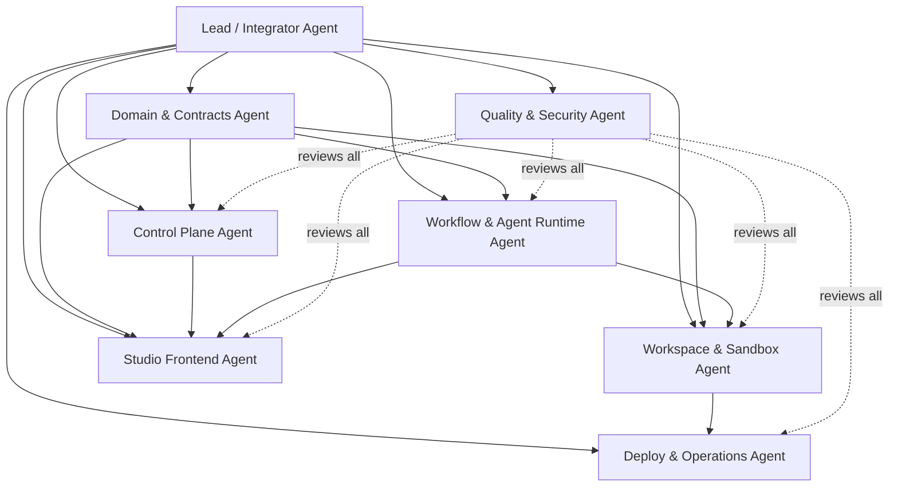

# Atoms Builder V1 多 Agent 联合开发方案（历史建设方案）

> 2026-11-11 归档（TASK-019）。固定团队、契约先行批次和从零搭建顺序仅保留作历史参考；不再要求每次维护任务启动整套团队。当前协作规则以 [AGENTS](../../../AGENTS.md) 和 [CONTRIBUTING-AGENTS](../../CONTRIBUTING-AGENTS.md) 为准。


本文描述“开发这个平台”的 Agent 团队如何协作。它和产品运行时的 Builder Agent、Reviewer Agent 是两层不同的概念：

- **开发团队 Agent**：负责编写 Atoms Builder 平台本身。
- **产品运行时 Agent**：平台上线后，替用户构建项目。

## 1. 推荐团队结构

建议使用 **1 个总控 Agent + 6 个模块 Agent + 1 个独立质量 Agent**。总数不要继续增加，除非某个模块已经形成稳定接口并且有明确的独立工作量。



## 2. 总控 Agent：Lead / Integrator

这是唯一拥有全局视角的 Agent。它不应该承担大量具体编码，而应该负责边界、顺序、合并和验收。

### 职责

- 阅读并维护 `CONTEXT.md`、`DESIGN.md` 和 ADR。
- 把设计文档拆成可独立验收的任务。
- 为每个任务指定唯一 Owner Agent。
- 维护依赖图、任务状态和版本目标。
- 解决跨模块接口冲突。
- 审核数据库迁移、公共类型和公共包变更。
- 负责集成分支和垂直切片验收。
- 决定何时停止并行开发，进入集成测试。

### 不负责

- 不直接创建第二套领域模型。
- 不绕过模块 Owner 修改其内部实现。
- 不允许多个 Agent 同时修改同一个核心文件。
- 不以“所有 Agent 都完成”为完成标准，而以可运行的垂直切片为标准。

### 总控 Agent 的核心产物

```text
docs/CONTRIBUTING-AGENTS.md
docs/TASK-BOARD.md
docs/INTERFACES.md
docs/INTEGRATION-STATUS.md
```

## 3. Domain & Contracts Agent

这是最先启动的 Agent，负责把设计文档转成稳定的领域类型和模块接口。

### 所有权

```text
packages/domain/
packages/contracts/
packages/persistence/schema.ts  # 只负责类型和迁移契约，不负责 Repository 实现
docs/INTERFACES.md
```

### 交付内容

- `Organization`、`Project`、`ProjectVersion`、`Run`、`RunStep`、`RunEvent`、`Artifact`、`Approval` 类型。
- Run 和 Step 状态机。
- Zod 输入输出 Schema。
- SSE 事件 Schema。
- Agent、Tool、Workspace、Deployment 的接口。
- 错误码和错误分类。
- 幂等键和版本并发规则。

### 验收标准

- 所有公共接口可以被 TypeScript 编译。
- 状态机对非法跳转有测试。
- JSON Schema 可以验证成功、失败、审批和取消事件。
- 不包含数据库驱动、模型 SDK、E2B SDK 或 React 依赖。

这是整个团队的第一条依赖。其他 Agent 在接口未冻结前只能提交设计和 Fake 实现，不能私自定义新的领域类型。

## 4. Control Plane Agent

负责用户、组织、项目、版本、Run、事件、审批和额度的后端控制面。

### 所有权

```text
apps/control-api/
packages/persistence/
packages/auth/
packages/billing/
migrations/
```

### 交付内容

- 数据库迁移和 Repository。
- Session、组织成员和角色权限。
- 项目和版本接口。
- Run 创建、查询、取消和审批接口。
- SSE 事件读取接口。
- Idempotency-Key 处理。
- Usage Ledger 的预留、提交和释放。

### 不负责

- 不调用模型。
- 不启动沙箱。
- 不运行用户生成代码。
- 不在 API 内部实现 Agent Loop。

### 验收标准

- 使用 Fake Workflow 可以创建完整 Run。
- 两个组织之间无法读写对方项目。
- 重复请求不会创建重复 Run 或重复扣费。
- SSE 断线后可以从 `Last-Event-ID` 继续读取。

## 5. Workflow & Agent Runtime Agent

负责 Coordinator、Builder/Reviewer 的运行时框架、模型调用和 Temporal 编排。

### 所有权

```text
apps/workflow-worker/
packages/agent-runtime/
packages/model-gateway/
packages/workflows/
prompts/
```

### 交付内容

- Coordinator。
- Agent Loop。
- Tool Grant 和工具权限检查。
- Model Gateway 和 Provider Adapter。
- Builder Agent 定义。
- Reviewer Agent 定义。
- Intake、Build、Review、Repair、Publish Workflow。
- Prompt 版本管理。
- Token、步骤数和费用限制。

### 不负责

- 不实现 E2B 细节。
- 不直接修改数据库表。
- 不实现 Studio UI。
- 不在 Prompt 中硬编码数据库或部署实现。

### 验收标准

- Fake Model 能跑通 Builder → Reviewer → Repair。
- Reviewer 默认没有写工具。
- Builder 每次变更都产生 `ProjectVersion`。
- 修复最多 3 次，超过后进入人工决策。
- Workflow Worker 重启后可以继续 Run。

## 6. Workspace & Sandbox Agent

负责项目文件、版本快照、命令执行、预览、截图和隔离沙箱。

### 所有权

```text
packages/workspace/
apps/sandbox-runner/
packages/artifacts/
packages/preview/
```

### 交付内容

- `Workspace` 接口的 Local Adapter。
- SelfHostedContainer Adapter；E2B 作为可选 Adapter。
- 文件读取、补丁应用和版本快照。
- 安全路径检查。
- 受控命令执行。
- Preview 生命周期。
- Playwright 调用 Adapter。
- Artifact 上传和引用。

### 不负责

- 不决定 Agent 应该做什么。
- 不负责项目权限判断。
- 不负责计费策略。
- 不负责生产发布 Provider。

### 验收标准

- 同一组 Workspace Contract Tests 同时通过 Local 和 SelfHostedContainer Adapter；E2B Adapter 接入后复用同一套测试。
- 补丁失败不会留下半版本。
- 路径穿越、任意命令和超额资源会被拒绝。
- 沙箱销毁后无法继续访问项目文件。
- 预览绑定明确的版本 ID。

## 7. Studio Frontend Agent

负责用户工作台，但不实现业务规则和 Agent Loop。

### 所有权

```text
apps/studio/
packages/ui/
```

### 交付内容

- 项目列表和新建项目。
- Chat Composer。
- Run Timeline。
- Agent 工具调用和日志展示。
- 预览窗口。
- 文件树和只读代码查看器。
- Review Panel。
- Approval Card。
- 版本、恢复和发布页面。

### 不负责

- 不直接调用模型 Provider。
- 不在浏览器执行 shell。
- 不绕过 Control API 修改项目。
- 不解释后端状态机；只消费 Contracts 和事件。

### 验收标准

- 只使用 Fake API 就能完成完整 UI 演示。
- SSE 断线重连后不会重复渲染事件。
- Run 状态由事件和服务端状态驱动，而不是本地猜测。
- 审批按钮显示目标版本、风险、预计费用和回滚信息。
- 桌面和移动宽度下核心流程可用。

## 8. Deploy & Operations Agent

负责构建产物、部署、回滚、环境配置、CI 和可观测性。

### 所有权

```text
packages/deployment/
packages/observability/
infra/
.github/workflows/
Dockerfile*
```

### 交付内容

- Build Artifact 接口。
- Fake Deployment Adapter。
- 一个真实部署 Provider。
- 稳定 URL 和部署状态。
- 回滚。
- OpenTelemetry Trace。
- Sentry 错误上报。
- 数据库、Worker、沙箱和 API 的健康检查。

### 不负责

- 不决定发布审批规则。
- 不读取用户的明文 Secret。
- 不修改生成项目源码。
- 不在 CI 中执行未隔离的用户代码。

### 验收标准

- 一个明确版本可以被构建、发布和访问。
- 发布失败不会把失败版本标记为线上版本。
- 回滚可以回到上一个部署版本。
- 每次部署能关联到 Run、Version 和 Artifact。

## 9. Quality & Security Agent

这是独立的质量 Agent，不应该和实现 Agent 共享“自己写自己验”的完成标准。

### 所有权

```text
tests/
evals/
security/
playwright/
docs/THREAT-MODEL.md
```

### 交付内容

- Domain、Contract 和状态机测试。
- Workflow 测试。
- Workspace Adapter Contract Tests。
- 浏览器黄金任务集。
- Agent 评测集。
- Prompt 回归测试。
- Secret、路径穿越、权限越界和资源耗尽测试。
- 发布前检查清单。

### 验收标准

- 所有模块有明确的测试命令。
- 至少 30 个固定构建任务可以重复运行。
- 能检测 Builder 修改受保护文件。
- 能检测 Reviewer 越权写入。
- 能检测跨组织数据泄漏。
- 能检测重复扣费和重复部署。

## 10. 启动顺序和并行边界

### 阶段 A：契约先行

只有 Domain Agent 和 Lead Agent 工作：

```text
CONTEXT.md
→ domain types
→ state machine
→ public interfaces
→ event schemas
→ error codes
```

### 阶段 B：Fake 垂直切片

以下 Agent 可以并行：

- Control Plane：数据库和 Fake API。
- Workspace：Local Adapter。
- Workflow：Fake Model、Fake Builder、Fake Reviewer。
- Studio：Fake API 驱动的 UI。
- QA：第一批 Contract Tests。

Lead Agent 在这一阶段禁止接入真实模型或真实云服务，先确保五个模块可以运行同一条 Fake Run。

### 阶段 C：接入真实执行

依赖顺序：

```text
Workspace Contract
  → SelfHostedContainer Adapter
  → Real Builder
  → Real Reviewer
  → Browser Checks
  → Temporal Worker
```

模型和沙箱可以并行开发，但不能在各自的临时接口上长期发展。接入时必须回到 `packages/contracts`。

### 阶段 D：发布和运营

```text
Artifact Contract
  → Fake Deployment
  → Real Deployment Provider
  → Approval Gate
  → Rollback
  → Billing / Observability Hardening
```

### 不允许并行的工作

- 两个 Agent 同时修改同一张核心表。
- 两个 Agent 同时修改 `packages/contracts`。
- Builder Prompt 和 Reviewer Prompt 同时大改而不更新评测集。
- Workspace 和 Deployment 同时决定 Artifact 格式。
- 前端根据自己猜测的状态添加新的 Run 状态。

## 11. 任务拆分格式

Lead Agent 分配任务时，每个任务必须包含：

```md
# TASK-012

Owner: Workspace Agent
Depends on: TASK-003, TASK-006
Scope:
- 实现 LocalWorkspaceAdapter
- 实现 applyPatch 原子提交

Allowed paths:
- packages/workspace/**
- tests/workspace/**

Forbidden paths:
- packages/contracts/**
- apps/studio/**
- migrations/**

Inputs:
- Workspace interface v1
- Version rules v1

Acceptance:
- patch success creates candidate version
- patch failure creates no version
- all Workspace Contract Tests pass

Output:
- changed files
- exported interfaces
- test command
- known risks
```

没有 `Allowed paths`、`Acceptance` 和 `Depends on` 的任务不应开始执行。

## 12. Agent 之间的交付协议

每个 Agent 完成任务后必须返回结构化报告：

```json
{
  "taskId": "TASK-012",
  "status": "completed",
  "changedPaths": ["packages/workspace/src/local-adapter.ts"],
  "publicChanges": ["WorkspaceAdapter.createSnapshot"],
  "migrations": [],
  "checks": [
    { "command": "pnpm test workspace", "status": "passed" }
  ],
  "risks": [],
  "handoff": "Ready for Workflow Agent integration"
}
```

失败报告必须包含：

- 已尝试的命令。
- 完整错误类别。
- 是否可以重试。
- 是否污染了工作区。
- 需要哪个 Agent 决策。

禁止只返回“已完成”或“测试通过”。

## 13. 分支和文件隔离

推荐使用一个主集成分支和每个 Agent 一个短生命周期分支：

```text
main
└── integration/v1
    ├── agent/domain-task-003
    ├── agent/control-task-010
    ├── agent/runtime-task-014
    ├── agent/workspace-task-012
    ├── agent/studio-task-020
    └── agent/qa-task-025
```

如果运行环境只有共享工作区，则使用 `Allowed paths` 强制文件所有权，并让 Lead Agent 串行合并公共契约和迁移。

Agent 合并前必须通过：

1. 自己模块的测试。
2. 依赖模块的 Contract Test。
3. TypeScript 编译。
4. Lead Agent 的集成分支测试。

## 14. 冲突处理规则

### 接口冲突

由 Domain Agent 提出两个候选接口，Lead Agent 选择一个并写入 `docs/INTERFACES.md`。禁止在调用方分别兼容两个版本。

### 数据库冲突

迁移只能由 Control Plane Agent 提交，其他 Agent 通过事件或 Repository 接口使用数据。迁移一旦进入集成分支，不能由其他 Agent 重写历史迁移。

### Prompt 冲突

Prompt 是代码。Builder 和 Reviewer Prompt 必须版本化，变更必须同时更新评测集和成本基线。

### 测试冲突

失败测试先由 QA Agent 分类：产品 bug、契约问题、环境问题、模型波动或测试错误。不能通过放宽断言来消除失败。

## 15. Lead Agent 的每日循环

```text
1. 读取任务状态和最新失败。
2. 检查是否有接口漂移。
3. 检查是否有 Agent 越过 Allowed paths。
4. 合并已通过 Contract Test 的任务。
5. 运行当前垂直切片。
6. 将集成失败分派给唯一 Owner。
7. 更新 TASK-BOARD 和 INTEGRATION-STATUS。
8. 只有垂直切片稳定后才开放下一批并行任务。
```

Lead Agent 的决策优先级：

```text
数据正确性
→ 租户和沙箱安全
→ 版本和恢复能力
→ 核心闭环可运行
→ 测试可重复
→ 成本可控
→ 用户体验
→ 次要功能
```

## 16. 推荐的第一批任务

```text
TASK-001  Domain Agent       定义领域类型和状态机
TASK-002  Domain Agent       定义公共接口和事件 Schema
TASK-003  QA Agent           建立 Contract Test 框架
TASK-004  Control Agent      创建数据库迁移和 Repository
TASK-005  Workspace Agent    实现 Local Workspace Adapter
TASK-006  Runtime Agent      实现 Fake Model 和 Fake Agent Loop
TASK-007  Studio Agent       实现 Fake API 驱动的工作台
TASK-008  Lead Agent         集成 Fake Run 端到端演示
TASK-009  Workspace Agent    实现 SelfHostedContainer Adapter
TASK-010  Runtime Agent      接入真实 Model Gateway
TASK-011  QA Agent           建立 Builder/Reviewer 黄金任务集
TASK-012  Runtime Agent      接入真实 Builder 和 Reviewer
TASK-013  Deploy Agent       实现 Fake Deployment
TASK-014  Deploy Agent       实现真实部署 Provider
TASK-015  Lead Agent         加入审批、发布和回滚
```

其中 `TASK-008` 是第一个硬闸门。在它通过之前，不增加新的 Agent 角色、不增加新的模板、不接入付费集成。

## 17. 何时增加新的开发 Agent

只有满足以下条件才增加 Agent：

- 现有 Owner 的任务可以通过一个明确接口独立交付。
- 新工作有至少两个独立任务，并且预计超过一天。
- 新 Agent 不会和现有 Agent 争用同一组文件。
- Lead Agent 能定义清晰的验收标准。

否则，增加 Agent 只会增加上下文同步、冲突和重复实现。

## 18. 最终团队验收

整个开发团队只有在以下演示成功后才算完成一期：

```text
新建项目
→ 输入自然语言需求
→ Builder 生成页面
→ Sandbox 启动预览
→ Reviewer 执行浏览器流程
→ Reviewer 发现问题
→ Builder 修复问题
→ Reviewer 通过
→ 用户审批
→ 发布稳定地址
→ 用户再次修改
→ 新版本可预览、可回滚、可再次发布
```

如果这个流程还不能稳定重复，团队应继续修复现有模块，而不是继续增加 Agent 角色。
