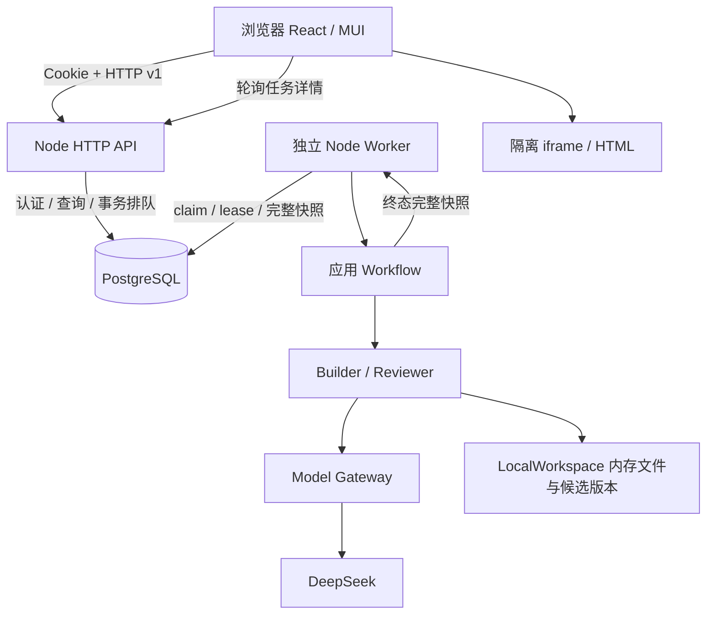

# 01 整体设计与运行链路

[返回手册](<README.md>) · [下一章：Web 前端](<02-web.md>)

## 1. 产品实际交付范围

Atoms Builder V1 是带账号和历史任务的 AI Web 构建应用。用户描述需求，后台生成源码和独立 HTML、进行源码审查，再在浏览器隔离展示 HTML；用户可以在同一任务继续修改。数据保存在 PostgreSQL，API 和 Worker 可以重启后重新读回已保存状态。

产品只由 Worker 使用 `DSKEY` 调用 DeepSeek；缺少配置时明确失败，没有替代模型回退。历史记录保留。

当前源码能表达或生成 Next.js 文件，但没有接入生产隔离执行器来真正安装依赖、构建、测试、启动 Next.js 服务。Reviewer 的模型源码审查是真实能力，命令和浏览器执行仍是模拟。真实发布、回滚、组织管理、导出和产品取消也没有完整用户路径。完整缺口见 [STATUS](<../STATUS.md>)。

## 2. 运行拓扑

三个运行单元的边界：

| 单元 | 做什么 | 实现入口 |
|---|---|---|
| 浏览器 | 页面、会话识别、提交、轮询、展示已有结果和隔离预览 | [main.tsx](<../../apps/web/src/main.tsx>)、[App.tsx](<../../apps/web/src/app/App.tsx>) |
| API | 同源检查、Cookie 身份、Schema、所有权、事务排队、静态站点托管 | [server.ts](<../../apps/platform-server/src/server.ts>)、[frontend.ts](<../../apps/platform-server/src/frontend.ts>) |
| Worker | 消费 PostgreSQL 队列、续约、调用模型、审查/修复、保存终态 | [worker.ts](<../../apps/platform-server/src/worker.ts>)、[workflow.ts](<../../apps/platform-server/src/workflow.ts>) |

API 和 Worker 分别启动，但通过 [bootstrap.ts](<../../apps/platform-server/src/bootstrap.ts>) 使用同一个 `ApplicationRepository` 实现和迁移。每个进程建立自己的连接池，不共享内存对象。没有应用内存数据库兜底。

本机源码模式把 API/Worker 放在宿主运行；Compose 模式把二者放进相同镜像的不同容器，业务与数据库没有第二套实现。当前 [Compose](<../../docker-compose.yml>) 未启动 Redis、Temporal 或沙箱占位服务。

## 3. 领域对象如何对应到界面

术语来源见 [CONTEXT](<../../CONTEXT.md>)，这里解释现有实现的对应关系，不扩展领域定义。

| 对象 | 在当前网站中如何使用 |
|---|---|
| User / Session | 用户名密码账号；浏览器拿 Cookie，数据库保存会话摘要 |
| Organization / Membership | 注册时创建个人组织和 owner 成员；当前权限查询仍按项目 `owner_user_id`，没有团队共享 UI |
| Project / Task | 一条历史任务，一个持续修改的作品；URL 中 taskId 就是 Project ID |
| Run | 每次首次构建或继续修改；独立请求、幂等键、状态、错误和结果 |
| Project Version | 完整源码不可变快照；输入模板、成功版本和失败候选都可存储 |
| Workspace | 单次运行的内存候选文件与版本接口；不代表宿主文件夹或真实容器 |
| Review / Preview | 绑定明确版本的审核与 HTML；结果通过 Run 和 Version 存储 |

必须区分三组状态：数据库 Run 是 `queued/running/completed/failed`；页面 Task phase 是 `queued/running/succeeded/failed`；Workflow result 可出现 `awaiting_fix_decision` 等状态。应用把未通过审核的终态记为失败运行，并没有真正暂停等待审批的产品流程。字段以 [Application v1](<../../packages/contracts/src/application-v1.ts>) 为准。

## 4. 一次新建与继续修改的全过程

1. 前端提交 `{request, idempotencyKey}` 到 `/api/tasks`。服务端从 Cookie 取得用户，客户端不能指定 userId 或旧 HTML。
2. `createTask` 在事务中创建 Project、包含初始文件的持久化模板 Version 和 queued Run，Run 明确绑定 `input_version_id`；返回 202 后即可跳转详情。
3. Worker 用 `FOR UPDATE SKIP LOCKED` 取一个 queued Run，写入 lease owner 和到期时间，并加载输入版本完整 `source_files`。
4. `executeApplicationRun` 用完整文件恢复 LocalWorkspace，构建候选、检查独立 HTML、源码审查，必要时最多三轮修复。具体流程见 [构建引擎](<04-build-engine.md>)。
5. `finishRun` 检查租约仍有效，事务保存完整文件、manifest、审核、HTML 和 Run 结果，替换临时候选 ID 为持久化 UUID。
6. 成功时推进项目指针；失败则保留上次成功作品。浏览器轮询详情看到终态。
7. 继续修改走 `/api/tasks/:id/runs`，`modifyTask` 从上次成功版本开始；如果从未成功则从项目已有输入版本开始。不会从浏览器预览或失败候选自动重建上下文。

详细事务和状态投影见 [API 与数据](<03-api-and-data.md>)。这一链路最适合排查“提交成功但没更新”“刷新后结果不对”等跨模块故障。

## 5. 版本与失败的设计

源码快照内容不覆盖；“当前版本”指针和版本的生命周期 `status` 可以改变。LocalWorkspace 内的临时版本与数据库最终 UUID 也不是同一套 ID：对外展示和后续输入必须用持久化 ID。

当一个任务已经成功过，再次修改失败：

- 最新 Run 和 Task phase 显示失败，本轮错误和 Run 历史保留。
- Task `currentVersionId`、主 `result` 和 `previewHtml` 优先取上次成功版本。
- 审核未通过但 Workflow 正常返回时，会保存失败候选版本；模型异常或保存异常走 `failRun`，通常只有失败 Run，没有新的源码快照。

这解释了为什么“页面显示旧审核通过，同时本轮运行失败”可以同时成立。修复 UI 时不能用旧版 review pass 来将本轮标成成功。

恢复粒度是 Run 和完整输入快照，不是 Agent 内部步骤。queued 可继续被消费；过期 running 由 Worker 标失败，避免自动重复潜在付费调用。没有 Temporal/SSE 或中间步骤重放。

## 6. 仓库结构与装配边界

| 目录 | 职责和阅读入口 |
|---|---|
| [apps/web](<../../apps/web/>) | 当前用户网站；[Web 章节](<02-web.md>) |
| [apps/platform-server](<../../apps/platform-server/>) | 名字保留 local，但也是当前容器生产 API/Worker；[API 章节](<03-api-and-data.md>) |
| 未装配的领域接口 | `packages/contracts/src/events.ts`、`deployment.ts` | 当前网站不装配事件投影或生成项目发布 |
| [packages](<../../packages/>) | 领域、契约、模型、Agent、Workspace 与持久化；[公共包章节](<05-packages-and-contracts.md>) |
| [migrations](<../../migrations/>) | PostgreSQL 基线和应用增量迁移 |
| [prompts](<../../prompts/>) | 运行时加载的 Builder/Reviewer Prompt，不是普通说明文档 |
| [scripts](<../../scripts/>)、[deploy](<../../deploy/>) | 环境、数据库、进程、部署辅助与静态检查 |
| [tests](<../../tests/>)、[evals](<../../evals/>) | 跨包契约/集成/端到端和黄金任务；包内另有各自 test |
| [docs](<../>) | 当前事实、维护规则、ADR、验收记录及本项目说明手册 |

当前网站的活动调用链以 ApplicationRepository、Worker、Agent Runtime 和 DeepSeek Gateway 为边界。新增功能先看实际装配，再决定是否扩展 Contracts 或新增 Adapter；未装配的领域接口不会自动改变当前产品。

## 7. 开发与运行边界

- 服务端授权以会话用户和数据库 owner 条件为准；跨用户资源统一 404。
- API 不同步跑模型；后台模型处理不受页面关闭影响。
- Reviewer 只读，不授予写文件工具；生成代码不在 API/Worker/宿主直接执行。
- HTML 留在 sandbox/CSP iframe，不注入平台 DOM；需要真实执行时接入隔离 Adapter。
- 迁移只追加，已应用 SQL 的 checksum 不能改；不删数据库卷处理应用故障。
- 模型密钥只在后端环境；错误日志采用受控分类，不记录 Provider 异常原文或完整生成源码。
- 平台自身 Compose 部署和“发布生成项目”是不同功能；后者仍缺真实 Provider、审批、幂等和审计闭环。

长期取舍参阅 [ADR-0006](<../adr/0006-postgres-accounts-and-task-history.md>)，更完整的维护约束见 [ARCHITECTURE](<../ARCHITECTURE.md>)。
