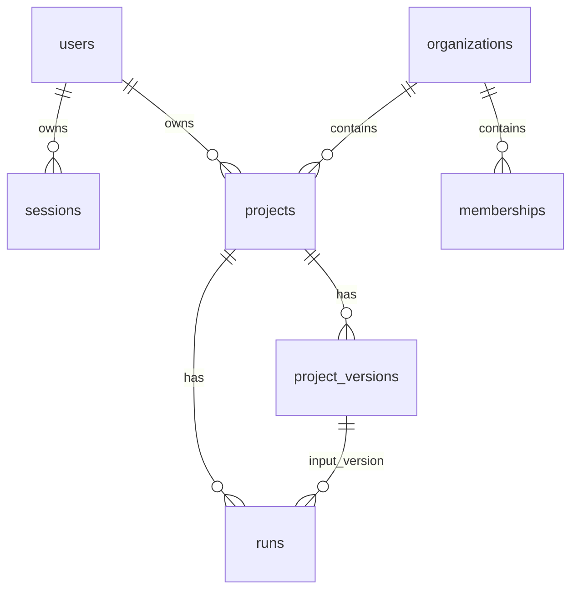

# 03 HTTP API 与数据持久化

[返回手册](<README.md>) · [整体设计](<01-architecture.md>) · [下一章：构建引擎](<04-build-engine.md>)

## 1. 先找这几个实现

| 文件 | 职责 / 稳定定位符号 |
|---|---|
| [server.ts](<../../apps/platform-server/src/server.ts>) | `createServer`、`readBody`、`sameOrigin`、Cookie、路由、受控 HTTP 错误 |
| [application-v1.ts](<../../packages/contracts/src/application-v1.ts>) | 当前请求/响应 Zod Schema 和 DTO 类型 |
| [application.ts](<../../packages/persistence/src/application.ts>) | `ApplicationRepository`，认证、SQL、事务、版本、队列与租约 |
| [postgres.ts](<../../packages/persistence/src/postgres.ts>) | `createApplicationPool`、`transaction`、迁移器 |
| [bootstrap.ts](<../../apps/platform-server/src/bootstrap.ts>) | 建池 → 迁移 → Repository → ready；失败关池 |
| [0001](<../../migrations/0001_control_plane.sql>) / [0002](<../../migrations/0002_application.sql>) | 原六表基线 / 当前应用增量 |
| [server.test.ts](<../../apps/platform-server/test/server.test.ts>) | 真实 PostgreSQL 的认证、权限、幂等、快照、租约和保存门禁测试 |

当前仓库没有单独的 Controller/Service/ORM 层：Node 原生 HTTP 分流，`ApplicationRepository` 直接用参数化 SQL。读写行为集中于该类，当前网站的数据库实现位于 `packages/persistence/src/application.ts`，不要从未装配的领域接口推断网站行为。

## 2. HTTP 入口和错误约定

以下路径由 `createServer` 处理，业务响应为 JSON，`cache-control: no-store`。任务接口要求 Cookie 会话。

| Method / 路径 | 输入与行为 | 成功 |
|---|---|---|
| GET `/healthz` | `repository.ready()` 执行 `select 1`；返回 mode | 200 |
| POST `/api/auth/register` | 用户名密码，事务注册并设置 Cookie | 201 `{user}` |
| POST `/api/auth/login` | 用户名密码，登录失败节流 | 200 `{user}` |
| GET `/api/auth/me` | 未登录也返回 `{user:null}` | 200 |
| POST `/api/auth/logout` | 撤销当前会话并清 Cookie，无 JSON body | 204 |
| GET `/api/tasks` | `page` 默认1，`pageSize` 默认20，上限100 | 200 summary 分页 |
| POST `/api/tasks` | `request` 与 `idempotencyKey`，创建并排队 | 202 完整 Task |
| GET `/api/tasks/:id` | owner 校验后读 Task、Run 历史及成功作品 | 200 完整 Task |
| POST `/api/tasks/:id/runs` | 同样写入结构，读取服务端输入版本 | 202 完整 Task |
| POST `/api/runs` | 已移除的匿名入口 | 410 |

`accountInputSchema` 将用户名 trim、转小写，限制 3–32 位字母/数字/下划线；密码 8–128 位。任务需求 trim 后 1–10000 字符，幂等键 8–128 字符。两个输入 Schema 都是 strict，额外的 `userId`、`previousHtml` 会被拒绝。HTTP body 另有 100000 字节上限。

对非 GET/HEAD/OPTIONS 请求，`sameOrigin` 在有 Origin 时允许与当前 host/protocol 一致或与 `APP_ORIGIN` 一致；没有 Origin 时该检查直接放行，不是完整独立的 CSRF token 方案。反向代理/HTTPS 配置要同步 `COOKIE_SECURE` 与 `APP_ORIGIN`。

常见状态：400 输入无效；401 未登录/凭据错误；403 跨站；404 不存在或非本人；409 重复账号、幂等冲突或已有运行；413 body 太大；429 登录节流。`ApplicationError` 的受控 message 返回客户端；未分类异常统一 503，不能为调试直接返回数据库异常或 Provider 原文。

`/healthz` 仅证明 API 能连数据库；mode 固定为 deepseek，modelConfigured 表示 API 进程的 `DSKEY` 是否存在，不证明 Worker 在线、key 有效或模型端可达。

## 3. 表与关联



图表达业务关联；并非每条关系都有同型外键。基线的 Project/Run/Version 等 ID 列是 text，当前实现写 UUID 字符串；新增 `users.id` 是 uuid。做迁移时以 SQL 类型为准，不能因为值长得像 UUID 就假设所有主外键都是 uuid。

| 表 / 字段 | 读写用途与注意事项 |
|---|---|
| `users` | 用户名归一化唯一、scrypt hash 和独立 salt；不向 DTO 返回密码字段 |
| `sessions` | `token_hash` 唯一、expires_at；不存原始 token |
| `auth_attempts` | 账号归一化与 remoteAddress 组合的 SHA256 key、失败次数、15分钟窗口 |
| `organizations` / `memberships` | 注册创建个人组织及 owner；不能据此宣称已有团队权限产品 |
| `projects` | owner、名称、当前版本、上次成功版本、更新时间；历史任务列表读这里 |
| `runs` | request、kind、input_version_id、幂等键、status、lease、error、result、完成时间 |
| `project_versions` | parent、source、manifest_hash、完整 source_files、manifest、preview_html、review、created_by_run_id |
| `run_events` | 0001 的追加事件表；当前应用 Workflow 没有把全量步骤事件写到这里，也没有真正 SSE |
| `application_migrations` | 每个迁移的 version/name/checksum/applied_at |

当前完整源码是 JSONB 文本映射 `Record<string,string>`，不是只存文件 hash 或对象存储。`sourceManifest` 对文件排序，计算内容 SHA256、字节数，`objectRef` 为 `postgres-version://...` 逻辑引用；这不表示已经部署对象存储下载服务。Workspace 与持久化分别产生 manifest，排查 hash 时应区分各自计算位置。

## 4. 认证的事务与安全边界

`register` 先生成随机 salt 与 scrypt hash，再在一个事务创建 User、Organization、Membership、Session。注册响应就设置登录 Cookie；用户名唯一冲突映射为409。

`login` 对 `${normalizedUsername}:${remoteAddress}` 摘要定位节流行并 `FOR UPDATE`。15分钟超过后重置窗口，失败10次后429；错误密码路径先返回内部空结果让事务提交计数，再在事务外抛401，避免计数被回滚。不存在用户时也做 dummy scrypt；正确用户用 `timingSafeEqual` 比较。成功删除该节流记录并创建会话。

会话 token 使用32字节随机数生成 base64url，仅 SHA256 入库，30天过期；Cookie 名 `atoms_session`，HttpOnly、SameSite=Lax、Path=/，`COOKIE_SECURE=true` 时加 Secure。`sessionUser` 要求摘要匹配且尚未过期；`logout` 删除摘要对应记录。

当前登录限流使用 socket remoteAddress，不解析 `X-Forwarded-For`；代理后不同客户端可能共享代理地址。修改这部分前需明确可信代理边界。没有密码重置、多因素认证或自动清理过期记录的后台产品流程。

所有任务详情/修改先按 `projects.id + owner_user_id + active` 查询；任务列表同样按 owner 过滤。组织成员角色目前不参与任务共享授权。若要做团队协作，不能只增加 UI，要贯穿 Repository 所有读写和契约测试。

## 5. 新建、修改与幂等

### 新建 `createTask`

事务级 advisory lock 锁 `${userId}:${idempotencyKey}`，查询当前用户已存在的 build：同 key 同 request 返回已有任务的当前投影；不同 request 返回409。

然后选用户最早个人组织，创建 Project。初始模板包含 `app/page.tsx` 和空的 `public/preview.html`，存为 candidate Version，项目 current 指向它，再插入 queued build Run。模板不是成功作品，因此 API `currentVersionId` 此时仍为 null。

### 修改 `modifyTask`

先锁 owner 项目行，再查询该项目/用户/key 的既有 Run。相同 modify/request 返回已有任务；不同请求或 kind 冲突返回409。没有复用时，检查是否有 queued/running，存在即409。

新 Run 的输入是 `last_successful_version_id ?? current_version_id`，因此有成功作品时不会拿失败候选做下一轮输入。创建后更新时间。要从失败候选继续，需要显式设计新行为和接口，当前不能靠客户端提交 HTML 绕过。

### 数据库兜底

[0002](<../../migrations/0002_application.sql>) 的 `runs_active_project_idx` 保证同项目最多一个 queued/running；`runs_initial_idempotency_idx` 保证用户首次 build 的 key 唯一，基线还限制项目/用户/key 唯一。

并发控制同时依靠锁、事务和索引。不能只删前端禁用按钮或只加内存锁解决重复执行。请求超时但不确定是否排队时应重用原幂等键；用户明确发起新一轮才用新 key。

## 6. Worker 租约对应的 Repository 方法

| 方法 | 数据库语义 |
|---|---|
| `recoverExpiredLeases` | running 且 lease 已过期 → failed，清理租约，记录中断提示；不自动排回 queued |
| `claimRun` | 按 created_at/id 取 queued，行锁 SKIP LOCKED；写 owner/lease，读输入完整快照 |
| `renewLease` | 只续本 owner、running、未过期租约；false 表示失去资格 |
| `finishRun` | 再锁定并校验活跃租约后事务保存快照和终态；无资格返回 false |
| `failRun` | 同样要求本 owner、running、未过期，只记失败和更新时间 |

`claimRun` 在事务中验证源码映射非空、值全为字符串。如果输入快照损坏会抛错并回滚 claim，不会静默用空模板；同一坏 queued 记录可能持续阻止顺序消费，需查数据与 Worker 退出日志。

Worker 默认60秒 lease，约每20秒续约；单 Worker 进程一次 await 一个 Run。可有多个 Worker 使用 SKIP LOCKED 领取不同项目；不等于有完整调度、容量和配额体系。丢租约后当前 execute 没有取消信号贯穿模型调用，可能继续消耗，但不会由该 owner 提交结果。详见 [构建引擎](<04-build-engine.md>)。

## 7. 终态提交与读取投影

`finishRun` 的 passed 条件同时要求 result.status 为 completed 和 review.status 为 pass。成功前还验证源码中的 `public/preview.html` 非空且等于 result.previewHtml；HTML 更深入的静态检查由 Workflow 负责。

每次正常终结创建新的持久化 UUID Version，重写 result 的 runId/versionId 和 `preview: {versionId,url: isolated:...}`。该 URL 是绑定版本的逻辑标识，不是可访问 HTTP 服务。

事务保存 Version 和 Run；成功时旧 current 的生命周期标记为 superseded，推进 current/last_successful 指针；失败候选为 failed，不推进指针。所谓不可变是源码内容/快照不可覆盖，并非生命周期字段永远不能变。

`task()` 查询最新 Run 决定 phase/lastRequest/error，再在已有成功版本时读取它关联的 result/previewHtml。这意味着主 result 不一定属于最新 Run；`runs[0]` 才是最新运行摘要。首次失败且没有成功版本时，正常终结的失败 result 可展示；直接异常失败时 result 可为 null。

`listTasks()` 用 lateral 子查询读最新 Run 和 summary 分页，不加载全部源码；`getTask()` 会读全部 Run 摘要和结果，暂无运行历史分页。任务量或版本量很大时，要先检查查询和 DTO 体积，而不是让浏览器缓存承担持久化。

## 8. 迁移与验证

迁移器扫描四位编号 SQL 排序，session advisory lock `72102201` 防止 API/Worker 同时执行。每个新迁移在独立事务执行并记 SHA256；已经存在编号但 checksum 变化会明确失败。不要修改0001/0002去适配已运行数据库，应追加新编号。

连接池要求 DATABASE_URL，max10、连接超时5秒。连接池 idle error 使用受控日志；`transaction` 负责 rollback/release。启动失败先检查连接、权限、迁移和 checksum，而不是改为内存 Repository。

相关验证命令（先按 [开发章节](<06-development-and-operations.md>) 初始化独立测试库）：

```sh
npm run test:contract
npm run test:local
npm run test:local
npm run test:restart
```

`test:local` 中 [真实PG测试](<../../apps/platform-server/test/server.test.ts>) 覆盖当前账号、任务和租约。无 TEST_DATABASE_URL 时 PG case 会 skip，必须检查测试报告里的 skipped，而非只看进程退出码。

改数据字段的完整顺序：追加迁移 → Repository SQL/DTO → Application Schema → API/client/UI → 契约与PG回归；不能只改页面或绕过迁移手动填列。常见问题见 [排障表](<07-extension-and-troubleshooting.md>)。
